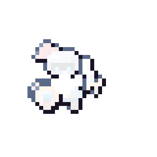
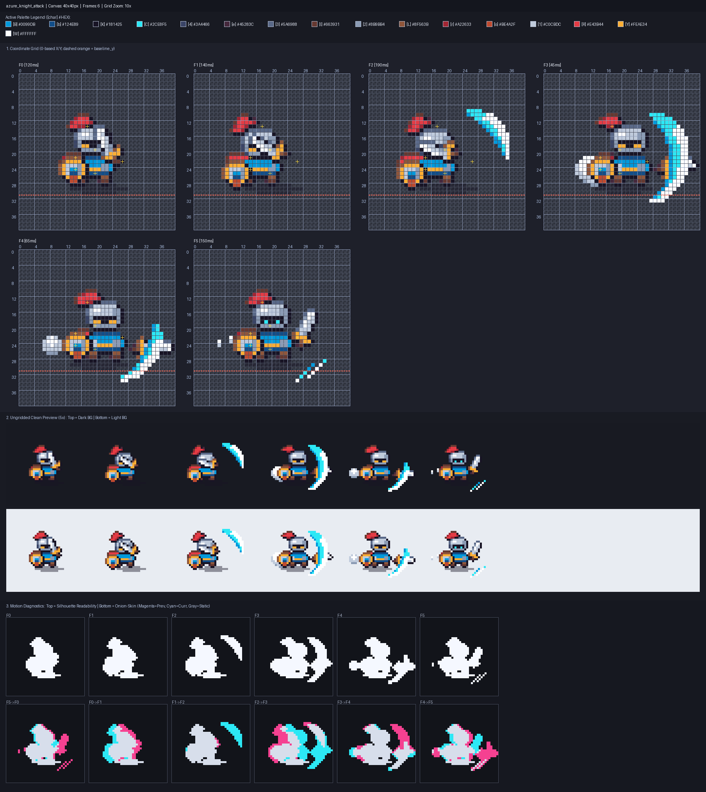
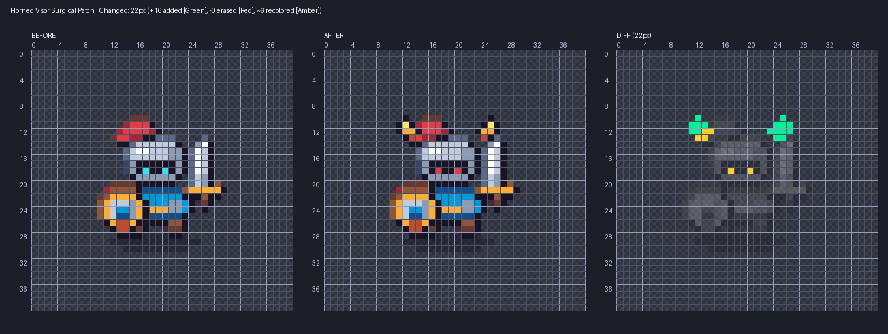
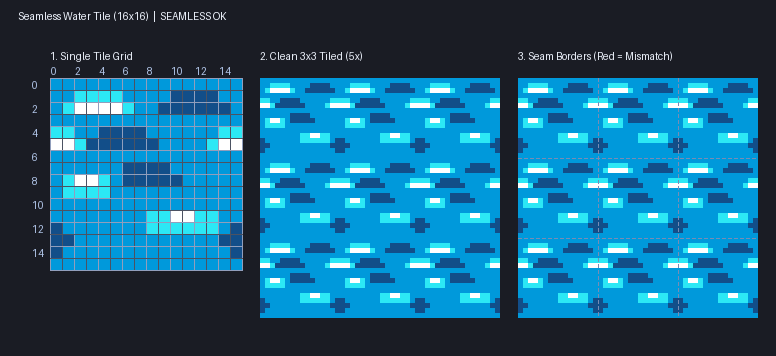
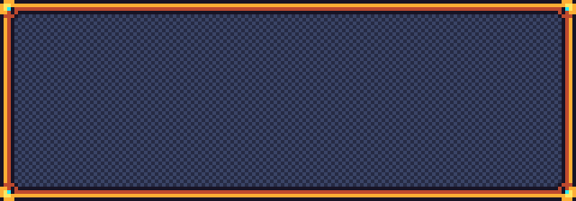

# PixelForge — 面向多模态视觉 LLM 的全栈像素画创作、精修与动画套件

`PixelForge` 是一套轻量级、零重型外部依赖（仅依赖 Python 标准库与 `Pillow` 9～14+）的像素资产工程库与 Agent Skill。专为具备多模态视觉能力的编码智能体（Antigravity、Claude Code、Codex 等）打造，打通了**从零构建 → 已有像素资产逆向拆解与局部手术精修 → 高分原画/AI 草图像素化 → 多部件骨骼动画 → 游戏引擎图集导出 → 全息视觉自检**的完整闭环。

---

## 核心特性与实测展示

### 1. 多部件骨骼 Rig + RotSprite 抗破碎旋转 + 多动作状态图集
支持紧凑局部组件组装、按分组自动包覆光源自适应描边（Sel-out）、3 阶 `Scale2x` 保色 `RotSprite` 旋转、非均匀帧率节奏（`durations_ms`）以及刀光/烟尘/受击星芒等预制粒子特效，一键导出 `GIF` / 真 8 位半透明 `APNG` / 无损动态 `WebP` 与 Aseprite 兼容 `JSON` 图集。

| 挥砍动作 (`attack`) | 待机呼吸 (`idle`) | 受击硬直 (`hit`) |
| :---: | :---: | :---: |
|  |  |  |

**全息多模态视觉自检看板**（集成了字符色板图例、`0` 起始坐标网格、无网格深/浅双底实机预览、纯白剪影与红青洋葱皮运动轨迹）：



---

### 2. 已有像素画逆向拆解 + 大图局部手术精修（Region Patch）+ 语义换色
- 自动通过横纵游程 GCD 检测 `4x`/`8x` 整数倍放大预览图并无损还原为 `1x` 原生像素画布。
- 支持按 `(X, Y, W, H)` 切出局部区域（自检标尺自动保留全局坐标），修补后输出 **Before / After / Diff** 三联像素级对比看板。

| 局部手术精修三联 Diff 看板 | 语义色阶重映射变体 |
| :---: | :---: |
|  |  |

---

### 3. 高分概念图 / AI 草图转真像素（Pixelate & Clean）
内置 `contrast_box`（面向平滑原画）与 `dominant_block`（面向网格歪斜发糊的 AI 伪像素图）双模式降采样、经典色板锁色与孤立杂点清理，生成可继续由视觉 LLM 逐像素点睛的干净工程。

| 左：256x256 柔光原画草图 → 右：32x32 锁色像素底稿 | 逐像素点睛玻璃高光 + 星芒动画成品 |
| :---: | :---: |
|  |  |

---

### 4. 无缝地图块（Tileset 3x3 接缝检验）与九宫格 UI（9-Slice）
自动比对跨边界色差与内部梯度，精准标红接缝断层行/列坐标；支持将迷你母版整数平铺扩展为任意尺寸的复古 UI 窗口并导出 `slices` 元数据。

| 3x3 无缝水面拼接自检看板 | 3x3 动态水面预览 | 9-Slice 整数平铺 RPG 对话框 |
| :---: | :---: | :---: |
|  |  |  |

---

## 一键安装（作为 Agent Skill）

确保环境已安装 `Pillow`（`pip install Pillow`），直接克隆到对应智能体的技能目录即可自动生效：

```bash
# Google Antigravity（全局）
git clone https://github.com/scvxzf1/pixel-forge.git ~/.gemini/config/skills/pixel-forge

# Claude Code（全局）
git clone https://github.com/scvxzf1/pixel-forge.git ~/.claude/skills/pixel-forge

# Codex CLI（全局）
git clone https://github.com/scvxzf1/pixel-forge.git ~/.codex/skills/pixel-forge

# 或挂载到任意项目级工作区
mkdir -p .agents/skills && git clone https://github.com/scvxzf1/pixel-forge.git .agents/skills/pixel-forge
```

---

## 目录结构

```text
pixel-forge/
├── SKILL.md                        # 核心 Agent 技能入口（渐进式披露，精炼工作流铁律）
├── scripts/
│   ├── pforge.py                   # 统一 CLI 命令行工具 & Python 顶层 API 入口
│   └── pixelforge/                 # 模块化核心引擎
│       ├── palette.py              # 6套经典色板、参考图吸色、HSV语义键分配、色相偏移明暗色阶、一键换色
│       ├── canvas.py               # ASCII网格编解码、局部切片精修(Patch)、抗锯齿几何画布与Bayer有序抖动
│       ├── importer.py             # PNG/GIF/APNG/WebP/精灵表逆向反编译、8x预览图自动无损还原、AI图像素化
│       ├── transform.py            # Scale2x + RotSprite 抗破碎像素旋转、Sel-out 光源描边、挤压拉伸、帧间拖影
│       ├── rig.py                  # 紧凑局部部件骨骼绑定(Rig)、分组描边、多动作状态角色(SpriteActor)
│       ├── vfx.py                  # 预制像素特效库（弯月刀光、赛璐璐烟尘、受击十字星芒、魔法闪烁）
│       ├── tileset.py              # Tileset 3x3 无缝拼接边缘断层检测、滚动水面、9-Slice 九宫格 UI 面板
│       ├── linter.py               # 代码级像素静态检查器（孤立噪点、轮廓漏口、曲线阶梯锯齿、体积/基准线异常）
│       ├── inspector.py            # 多模态全息自检看板（字符色板图例+坐标标尺+深浅双底预览+剪影+洋葱皮+Diff）
│       └── exporter.py             # GIF / 真半透明 APNG / 无损动态 WebP / 多行精灵表 / Aseprite JSON 导出
├── references/                     # 按需加载的专项技法手册
│   ├── craft_and_shading.md
│   ├── edit_and_pixelate.md
│   ├── animation_and_rigging.md
│   ├── tileset_and_ui.md
│   └── cli_and_api.md
├── examples/                       # 4 个独立可运行的端到端实战脚本
│   ├── 01_knight_multi_anim.py
│   ├── 02_edit_and_recolor.py
│   ├── 03_pixelate_concept.py
│   └── 04_tileset_and_9slice.py
└── tests/
    └── test_pixelforge.py          # 全模块自动化单元测试
```

---

## 常用 CLI 命令速览

```bash
# 1. 运行内置演示与全套自动化测试
python3 scripts/pforge.py demo -o output/demo
python3 tests/test_pixelforge.py -v

# 2. 对任意现有 PNG / GIF / 精灵表生成全息视觉自检看板与 Linter 诊断
python3 scripts/pforge.py inspect sprite.gif -o work/

# 3. 逆向反编译已有动图或精灵表为可编辑 Python 工程
python3 scripts/pforge.py decompile walk_sheet.png --cols 6 --rows 1 -o work/walk/

# 4. 大图局部手术切片与回写（自动生成 Before / After / Diff 三联对比图）
python3 scripts/pforge.py region-extract boss.png --box 16,8,24,20 -o work/patch/
python3 scripts/pforge.py region-apply boss.png --patch work/patch/boss_x16_y8_w24_h20.json -o work/patched/

# 5. 高分原画或 AI 概念图转干净像素底稿
python3 scripts/pforge.py pixelate concept.png --size 48x48 --palette endesga32 --outline "#181425" -o work/px/

# 6. 无缝地图块 3x3 检验 & 九宫格 UI 面板生成
python3 scripts/pforge.py tile water.png -o work/tile/
python3 scripts/pforge.py nine-slice frame.png --margins 5,5,5,5 --size 160x56 -o work/dialog.png
```

## License

[MIT](LICENSE)
